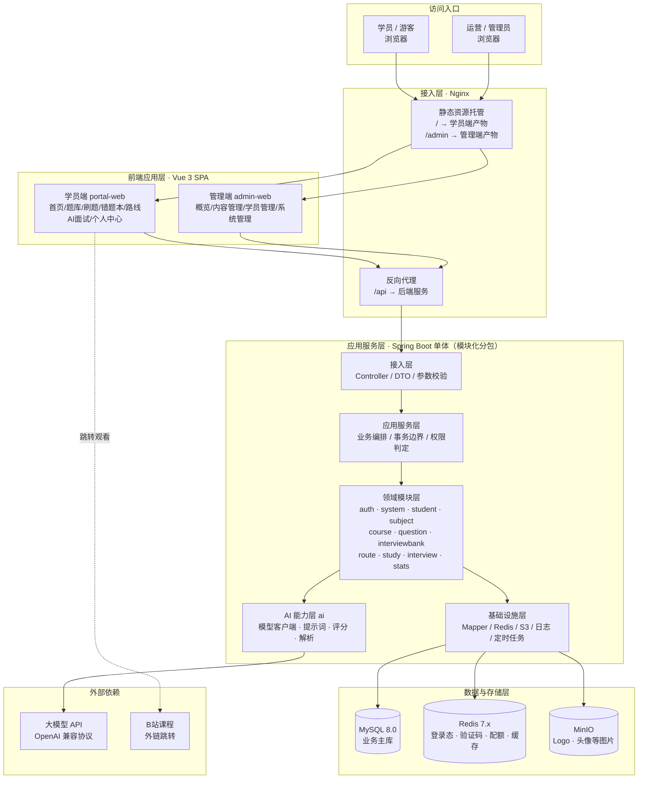
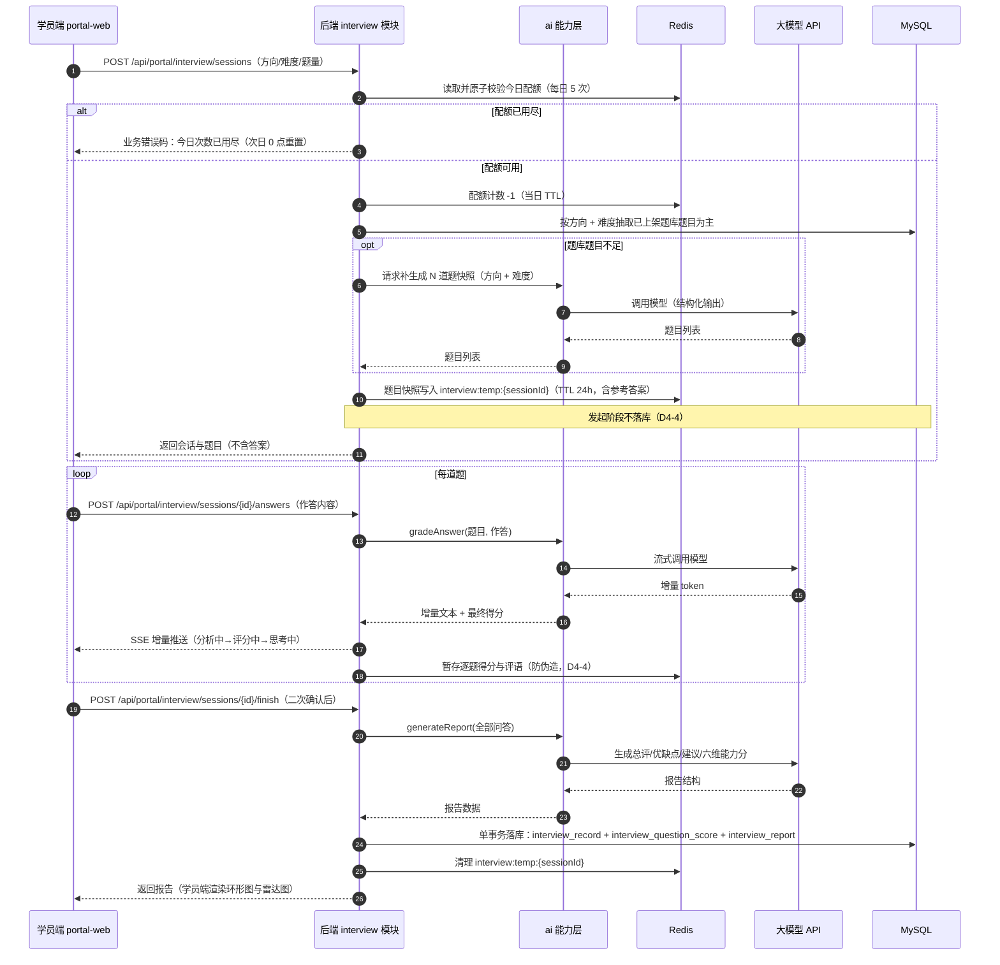
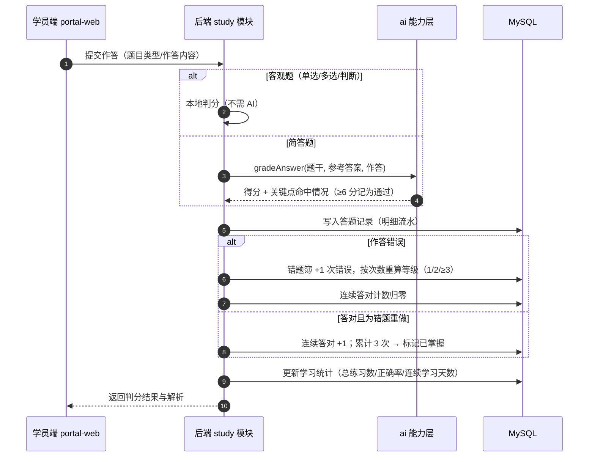
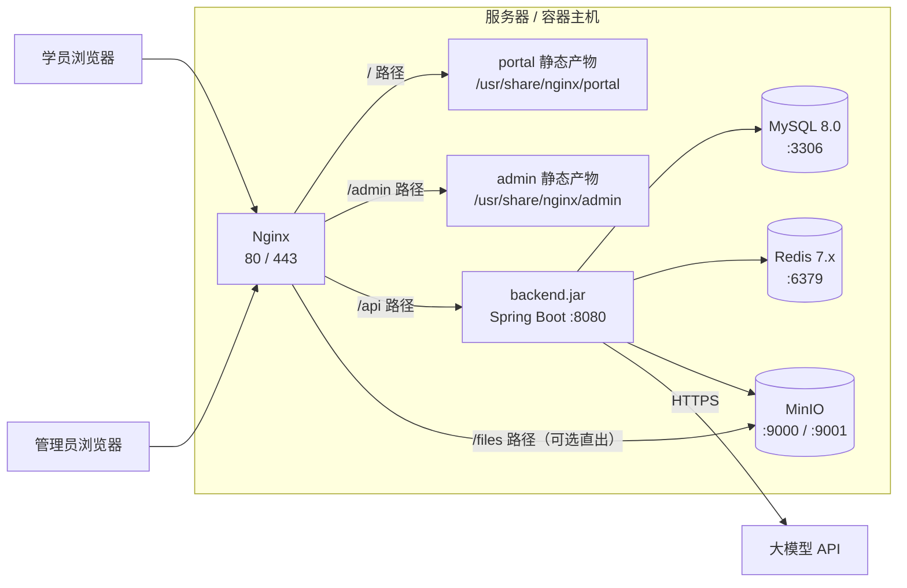
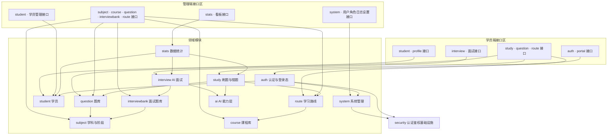
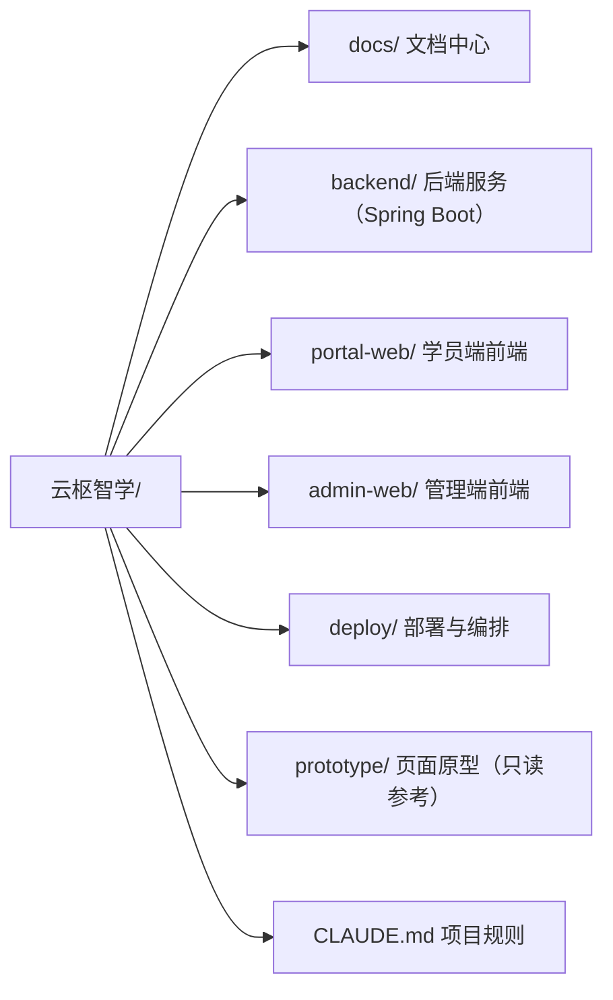

# 云枢智学 —— 整体架构设计

> 阶段：设计第二阶段（技术选型与整体架构设计）
> 状态：已确认（2026-11-08 设计评审定稿，裁决记录见 `05.设计方案评审结果.md`；T3/T7 已于 R-08 确认）
> 依据：`docs/design/01.功能模块梳理.md`（第一阶段已确认结论，16 项待确认问题全部闭环）、`docs/云枢智学-需求文档.md`（权威需求来源）、`prototype/`（25 个页面原型）、`docs/rules/database-rules.md`、`docs/rules/api-rules.md`范围：技术选型、整体架构与分层、模块架构、项目目录设计、关键设计决策与风险。
> 不涉及：数据库表结构与字段定义、API 接口清单与字段契约、业务代码实现。
> 标记约定：
>
> * ✅ 已确认：已与你交互确认的决策，直接作为后续设计约束。
> * 🔧 建议：我提出并说明依据的方案，**尚未确认**，不作为既定事实。
> * ⚠️ 待确认：尚未确定、需你裁决的问题（见第 5.2 节）。

***

## 1. 技术选型

### 1.1 前置说明：项目中既有的技术约束情况

对现有资料核查后的结论：

| **资料**                         | **是否含技术约束** | **说明**                                                                                                         |
| ------------------------------ | ----------- | -------------------------------------------------------------------------------------------------------------- |
| `docs/云枢智学-需求文档.md`            | 无           | 全篇为业务需求，未指定技术栈；仅 3.8.2 定义了「浏览器语音识别 + 不支持时降级」这一实现约束                                                             |
| `prototype/README.md`「技术说明」    | 原型约束        | 原型为纯 HTML + CSS + 原生 JS + MockData 模拟数据，属**原型实现方式**，非生产架构要求                                                    |
| `prototype/README.md`「后续开发建议」  | 参考建议        | 建议「Vue3/React 重构 SPA」「接入 ECharts」「WebSocket 支持实时 AI 对话」「接入真实后端 API」——属**建议**，其中 Vue3、ECharts、真实后端 API 已被本次选型采纳 |
| `docs/rules/database-rules.md` | 有（强约束）      | 自增主键、**禁止物理外键**、逻辑关联由应用层维护、snake\_case 命名、唯一值用唯一约束、日期统一时区策略                                                    |
| `docs/rules/api-rules.md`      | 有（强约束）      | REST 风格、统一响应结构、统一分页、HTTP 状态码与业务错误码分离、服务端必须校验输入                                                                 |

因此本项目**无既定技术栈约束**，技术选型按「需求匹配度 + 团队落地成本 + 与既有规范契合度」三项标准确定。

### 1.2 技术选型总览

| **层次**       | **选型**                               | **版本建议**                      | **决策状态** | **选型依据**                                                                                                |
| ------------ | ------------------------------------ | ----------------------------- | -------- | ------------------------------------------------------------------------------------------------------- |
| 后端语言         | Java                                 | 17（LTS）                       | ✅ 已确认    | 最主流 LTS，Spring Boot 3 的基线要求                                                                             |
| 后端框架         | Spring Boot                          | 3.2.x / 3.3.x                 | ✅ 已确认    | 后台管理类系统（RBAC、权限树、审核流、审计日志、Excel 导入导出）生态最成熟；与平台面向学员的技术语境（Spring 生态、微服务、Redis、数据库）一致                      |
| Web 层        | Spring MVC + Jakarta Validation      | 随 Boot                        | ✅ 已确认    | REST 接口 + 统一的参数校验，符合 `api-rules` 第 3 条「服务端必须校验所有输入」                                                     |
| 安全框架         | Spring Security + JWT（JJWT）          | 随 Boot                        | ✅ 已确认    | 双端独立登录态 + RBAC 权限点控制菜单/操作，注解式鉴权                                                                         |
| 持久层          | MyBatis-Plus                         | 3.5.x                         | ✅ 已确认    | 自增主键、逻辑删除、时间字段自动填充、分页插件开箱即用，与 `database-rules` 契合度最高；复杂统计可退化为 XML 原生 SQL                                |
| 数据库          | MySQL（InnoDB, utf8mb4）               | 8.0                           | 🔧 建议    | 业务为强关系型结构（学科-阶段-题目、路线-课程顺序、角色-权限），事务一致性要求明确；单库规模足够，无需分库分表                                               |
| 缓存 / 带过期语义存储 | Redis                                | 7.x                           | ✅ 已确认    | 承担双端登录态与登出黑名单、短信验证码（60s）、AI 面试每日 5 次配额计数（TTL 天然实现次日 0 点重置）、看板热点缓存、接口限流计数                                |
| 消息队列         | **不引入**                              | —                             | ✅ 已确认    | 本期无必须异步化的长时任务：AI 批改/评分走同步或流式，看板统计为库内聚合，Excel 导入单次上限 500 道可控；避免多一套运维成本                                   |
| 对象存储         | MinIO（S3 兼容协议）                       | RELEASE.2024+                 | ✅ 已确认    | 落盘文件仅平台 Logo、默认头像、学员头像等少量图片；代码按 S3 兼容接口实现，后续改配置即可切云 OSS/COS                                             |
| AI 能力        | 服务端统一 AI 能力层，适配 OpenAI 兼容协议          | —                             | ✅ 已确认    | 逐题评分、简答批改、报告生成、面试出题统一收敛到 `ai` 模块；模型与密钥走配置与环境变量（C5 已确认系统设置仅基本信息，不落库）                                     |
| AI 模型供应商     | 国内可直连模型服务（仅境内调用）                     | 配置化                           | ✅ 已确认    | 用户确认（T2）：数据不出境、无需代理、按 token 计费可控；协议层解耦后换供应商只改配置                                                         |
| 实时传输         | SSE（Server-Sent Events）              | —                             | ✅ 已确认    | 需求 3.8.2 的「分析中 → 评分中 → 思考中」提示与打字机效果是**服务端到前端单向流**；SSE 比 WebSocket 更轻、天然走过 Nginx（需关 buffering）、无需心跳与重连协议 |
| 语音识别 / 播报    | 浏览器 Web Speech API + SpeechSynthesis | —                             | ✅ 已确认    | 需求 3.8.2 明确「浏览器语音识别，识别结果写入输入框；不支持时降级并提示」；免去服务端音频存储与 ASR/TTS 接入                                          |
| 前端框架         | Vue 3 + TypeScript                   | Vue 3.4+ / TS 5.x             | ✅ 已确认    | 中文生态与文档最友好，两端共 25 个页面以列表、表单、弹窗、图表为主，Vue 开发效率高                                                           |
| 前端构建         | Vite + pnpm                          | Vite 5 / pnpm 9 / Node 20 LTS | ✅ 已确认    | 构建快、配置简单，产出静态资源交 Nginx 托管                                                                               |
| 前端状态 / 路由    | Pinia + Vue Router                   | 最新稳定版                         | ✅ 已确认    | 登录态、练习会话、面试会话的全局状态与路由守卫                                                                                 |
| UI 组件库       | Element Plus                         | 2.x                           | ✅ 已确认    | 管理端表格/表单/弹窗/上传/分页组件完备；学员端以原型视觉为准，通过主题变量覆盖适配                                                             |
| 图表库          | ECharts                              | 5.5+                          | ✅ 已确认    | 覆盖看板折线图与饼图（C4 已确认指标）、报告环形图、能力六维雷达图；与原型建议一致                                                              |
| Excel 导入导出   | EasyExcel（FastExcel）                 | 3.x                           | 🔧 建议    | 题库导入 `.xlsx/.xls` 单次 ≤500 道、导出 Excel、操作日志导出 CSV，均需流式读写避免 OOM                                            |
| Markdown 解析  | commonmark-java                      | 0.22+                         | 🔧 建议    | 面试题库「上传 .md 按 `#`\~`###` 标题切题、正文为参考答案」并输出源文件行号用于预览，需标准 Markdown 解析能力                                    |
| 接口文档与契约      | springdoc-openapi                    | 2.x                           | ✅ 已确认    | 自动生成 OpenAPI 契约 + Swagger UI，并导出 `openapi.json` 作为**两端类型与枚举的唯一契约源**（D21）                                |
| 后端构建         | Maven                                | 3.9+                          | 🔧 建议    | 单体多模块可选，配置最标准化                                                                                          |
| 部署           | jar + Nginx + Docker Compose         | Nginx 1.25 / Compose v2       | ✅ 已确认    | 后端打 jar，前端两端静态产物，Nginx 统一入口；开发与生产同构（MySQL 8 + Redis 7 + MinIO）                                          |

***

## 2. 整体架构设计

### 2.1 架构总览

**结论：模块化单体（Modular Monolith）+ 双前端应用 + 单库单缓存 + 对象存储。**（✅ 已确认）

* 一个后端服务，内部按业务领域分包，模块间单向依赖、只经服务接口与 DTO 交互；
* 两个前端应用（学员端 portal、管理端 admin）**独立构建、独立部署**，对应第一阶段已确认的「双端独立部署 + 两端账号体系独立、独立登录态」；
* 数据层为 MySQL 单库 + Redis + MinIO 对象存储；
* 不拆微服务：当前为单团队、单库、单一部署单元，微服务的分布式事务与联调成本远高于收益；模块化分包已预留后续按模块拆分的边界。



### 2.2 技术分层与各层职责

| **层**              | **职责**                                                                  | **关键约束**                                                        | **不做什么**                    |
| ------------------ | ----------------------------------------------------------------------- | --------------------------------------------------------------- | --------------------------- |
| 接入层（Nginx）         | 静态资源托管、API 反向代理、SSE 透传、上传体积限制                                           | `/` 与 `/admin` 分别指向两端产物；`/api` 代理后端；SSE 路径需关闭响应缓冲               | 不做业务鉴权（鉴权在后端，Nginx 仅可选做限流）  |
| 前端应用层（两个 SPA）      | 页面渲染、交互与本地校验、登录态持有、路由守卫、图表展示、语音识别与播报                                    | 两端各自持有独立 token，互不通用；不越权展示（菜单/按钮按权限码渲染）                          | 不做业务规则判定（如掌握判定、配额扣减一律以后端为准） |
| 接入层（后端 Controller） | 路由、参数校验、DTO ↔ 领域对象转换、统一响应包装                                             | 按 `api-rules` 校验全部入参；两端接口路径分区（`/api/portal/**`、`/api/admin/**`） | 不写业务逻辑，不直接访问 Mapper         |
| 应用服务层（Service）     | 业务编排、事务边界、跨模块调用、权限与配额校验、操作日志埋点                                          | 一个事务一个用例；跨模块调用只经对方 Service 接口与 DTO                              | 不拼装前端展示结构（由 Assembler 负责）   |
| 领域模块层（Modules）     | 承载第一阶段 8 个业务模块的业务规则与数据归属                                                | 模块内自闭环；**不得跨模块直接访问对方 Mapper/实体**                                | 不处理 HTTP 细节，不直连外部 AI        |
| AI 能力层（`ai`）       | 统一封装大模型调用：简答批改、面试出题、逐题评分、报告生成；提示词模板管理；超时/重试/降级                          | 只暴露领域语义接口（如 `gradeAnswer`、`generateReport`），模型细节不外泄             | 不感知业务表结构，不直接写库              |
| 基础设施层              | MyBatis-Plus Mapper、Redis 客户端、S3 客户端、对象存储抽象、日志、定时任务、Excel/Markdown 解析工具 | 技术细节下沉；对象存储经 `StorageService` 抽象，实现可切换                          | 不含业务判断                      |
| 数据与存储层             | MySQL 业务主库、Redis 缓存与过期数据、MinIO 图片对象                                     | 遵守 `database-rules`：自增主键、逻辑删除、禁物理外键、唯一值用唯一约束                    | —                           |
| 外部依赖               | 大模型 API（OpenAI 兼容）、B站课程外链                                               | 大模型不可用时降级；B站仅跳转不做抓取                                             | —                           |

### 2.3 关键运行时协作

**AI 面试逐题评分（含 SSE 流式）** —— 对应需求 3.8.2 与流程三：



**刷题与错题归集（含掌握判定）** —— 对应流程二：



### 2.4 部署拓扑



部署要点（均为 ✅ 已确认方式）：

1. **两端的独立部署**：学员端与管理端产物分别构建、分别部署到不同路径，互不影响发布节奏。
2. **同域分区统一入口**（D20）：Nginx 同域下以 `/`（学员端）、`/admin`（管理端）、`/api`（后端）分区，规避跨域；后端不配置 CORS 白名单，证书只维护一张。
3. **SSE 透传**：AI 面试流式接口所在路径需关闭 Nginx 响应缓冲（`proxy_buffering off`）、放宽读超时（需求规定单问 5 分钟超时，读超时须大于该值）。
4. **环境同构**：开发/测试环境用 Docker Compose 一键起 MySQL + Redis + MinIO，生产同构部署，减少环境差异。
5. **配置与密钥**：AI 的 base-url / model / api-key、数据库与 MinIO 连接信息全部走环境变量 + Spring profile（dev / prod），**不落库**（C5 已确认系统设置仅基本信息）。

### 2.5 横切设计

| **横切关注点**   | **设计要点**                                                                                                                                                                | **依据**                                   |
| ----------- | ----------------------------------------------------------------------------------------------------------------------------------------------------------------------- | ---------------------------------------- |
| 认证与登录态      | 两端**两套独立 token 域**：各自签发/验签密钥与过期策略，token 互不通用；access token 短效 + refresh token 续期；Redis 存 token 快照用于登出、禁用、改密后立即失效                                                         | C3 已确认「两套账号、独立登录态」                       |
| 权限控制（RBAC）  | Spring Security 过滤器链 + 注解式权限点校验；角色与权限点落库（权限树 9 组），后端按权限点控制接口，前端按权限码控制菜单与按钮可见性                                                                                           | A4/A5 已确认；权限点清单在权限设计阶段细化                 |
| 操作日志        | AOP 切面拦截管理端全部写操作 + 登录/登出 + 数据导出，异步落库（同进程线程池，不引入 MQ）；记录操作人、动作、对象、时间、IP                                                                                                   | B5 已确认                                   |
| AI 面试配额     | Redis 原子计数 + 当日 TTL，天然实现「每日 5 次、次日 0 点重置」；发起面试前校验，用尽返回业务错误码                                                                                                             | B2 已确认                                   |
| 接口限流与防刷     | Redis 计数器实现：登录失败锁定、验证码获取/校验频控、关键接口按 IP + 账号频次限制（阈值见需求文档 3.2），超限返回业务错误码并提示「操作过于频繁」                                                                                       | T6 已确认纳入本期                               |
| AI 能力降级     | 模型超时/失败重试后仍失败时：简答批改退化为关键词规则判分，面试评分退化为模拟评分并明确提示，主流程不阻断                                                                                                                   | 需求 3.8.2「不支持时降级并提示」的同类思路；🔧 建议           |
| 数据统计        | 明细流水为事实来源，统计指标（正确率、掌握率、看板计数与趋势）在查询时聚合，热点结果入 Redis 短时缓存                                                                                                                  | C4 已确认指标范围；🔧 建议缓存 5 分钟                  |
| 逻辑删除        | 全站统一逻辑删除，MyBatis-Plus 逻辑删除插件；查询默认过滤已删除数据                                                                                                                                | 第一阶段 2.3 已确认「删除语义：逻辑删除」；`database-rules` |
| 统一响应与异常     | 统一响应体结构与业务错误码，HTTP 状态码与业务码分离，参数校验错误指明字段                                                                                                                                 | `api-rules` 第 4、5 条（具体格式在 API 设计阶段定稿）    |
| 文件与静态资源     | 上传的图片经后端校验后写入 MinIO，返回可访问 URL；课程封面为外链 URL；题目导入 Excel 与面试题 Markdown **文件不入库**，仅留存文档名与行号等来源信息                                                                             | 需求 4.3.3/4.3.4 已定义；Q8/Q12 已确认            |
| 导入导出与解析的临时态 | **不新建任务表**：批量导入/导出全部**同步**完成（导入仍走「预览 + 校验 + 确认」两段式，预览结果以 token 形式暂存 Redis）；仅面试题**文档解析**（A-I06）天然异步，其任务态存 Redis（`content:parse:{taskId}`，TTL 2h）并提供进度查询（A-I14），无服务端持久化残留 | 阶段 4 交互确认 Q10（见 `04.API接口设计.md` §7.1）    |
| 时区策略        | 数据库统一 UTC 存储、展示层按 Asia/Shanghai 转换（`database-rules` 推荐）；**每日配额同样按 Asia/Shanghai 自然日 0 点重置**，与用户感知一致                                                                     | `database-rules` 第 3.5 条；D17             |

***

## 3. 模块架构设计

### 3.1 第一阶段业务模块 → 后端分包映射

第一阶段确认的 8 个业务模块 + 3 项支撑能力，在系统中的落点如下（后端模块粒度更细，但一一可追溯）：

| **第一阶段模块** | **端** | **后端包**                                                       | **前端页面归属**                                                                      | **核心职责**                                  |
| ---------- | ----- | ------------------------------------------------------------- | ------------------------------------------------------------------------------- | ----------------------------------------- |
| 账号与门户      | 学员端   | `auth` + `student`（Profile 部分）+ `stats`                       | portal-web `views/home`、`views/auth`                                            | 注册/登录/找回密码、首页内容聚合与平台数据展示、管理后台入口           |
| 学习训练       | 学员端   | `study` + `question`（读取）+ `route`（读取与勾选）                      | portal-web `views/questions`、`views/practice`、`views/wrong-book`、`views/routes` | 题库浏览、顺序/随机练习、客观题判分、错题归集与分级、掌握判定、路线学习与勾选完成 |
| AI 面试      | 学员端   | `interview` + `ai`                                            | portal-web `views/interview`                                                    | 面试配置与配额校验、对话式作答、逐题评分、报告生成、记录留存            |
| 个人中心       | 学员端   | `student` + `stats`                                           | portal-web `views/profile`                                                      | 资料维护、学习数据展示                               |
| 数据概览       | 管理端   | `stats`                                                       | admin-web `views/dashboard`                                                     | 看板指标、趋势图、学科分布、最近活动                        |
| 内容管理       | 管理端   | `subject` + `course` + `question` + `interviewbank` + `route` | admin-web `views/content`                                                       | 学科与阶段、B站课程库、题库与审核、面试题库（上传解析/手工录入）、学习路线    |
| 学员管理       | 管理端   | `student`                                                     | admin-web `views/student`                                                       | 学员列表、详情（学习数据/已学课程/面试记录）、禁用、导出             |
| 系统管理       | 管理端   | `system`                                                      | admin-web `views/system`                                                        | 后台用户、角色与权限树、操作日志、系统设置                     |
| 认证与权限（支撑）  | 两端    | `auth` + `security` 包 + `system`（角色权限）                        | 两端 `router` 守卫 + `store/user`                                                   | 两端独立登录态；管理端 RBAC 权限点控制菜单与操作               |
| AI 能力层（支撑） | 两端    | `ai`                                                          | 无独立页面（经业务页面调用）                                                                  | 简答批改、面试出题、逐题评分、报告生成；提示词与模型适配              |
| 数据统计（支撑）   | 两端    | `stats`                                                       | 首页/个人中心/看板/学员详情                                                                 | 学习统计、面试统计、看板运营统计                          |

### 3.2 后端模块依赖关系



**依赖规则（🔧 建议，作为代码评审硬约束）**：

1. **单向依赖**：上图箭头方向即允许的调用方向，禁止反向调用（如 `question` 不得调用 `study`）。
2. **不跨模块直连数据库**：任何模块只能访问自己拥有的表；跨模块取数一律经对方 Service 接口，返回 DTO，不得引入对方的 Mapper 与实体。**表归属明确**：`student` / `student_oauth` 归 M3（student），`admin_user` / `role` / `permission` / `role_permission` / `operation_log` / `system_setting` 归 M2（system）；M1（auth）的注册、登录、找回密码、第三方登录经 `StudentService` / `AdminUserService` 读写账号，不直接持有对方 Mapper（评审 R-10 裁决，对应图中 `M1 → M3`、`M1 → M2`）。
3. **共享底座只读不改**：`subject` 是内容体系根节点，`question`/`interviewbank`/`route`/`course` 依赖它但不得修改其数据。
4. **`ai` 无状态、无业务库依赖**：`ai` 只接收入参、返回结构化结果，不做落库（落库由调用方负责），便于替换模型与单独测试。
5. **`stats` 只读**：统计模块只读各模块数据，不参与业务写入。
6. **`security` 与 `common` 为最底层**：不依赖任何业务模块，任何模块均可依赖。

### 3.3 前端模块结构

两端均为 Vue 3 SPA，目录与页面按第一阶段模块组织，通过路由懒加载切分：

| **端**      | **登录态**                      | **路由分区**                                 | **关键状态（Pinia）**                                                                    |
| ---------- | ---------------------------- | ---------------------------------------- | ---------------------------------------------------------------------------------- |
| portal-web | 学员 token（localStorage + 请求头） | 公开区（首页/题库/登录注册）、登录区（刷题/错题本/路线/AI面试/个人中心） | `useUserStore`（用户与登录态）、`usePracticeStore`（练习会话与断点续练）、`useInterviewStore`（面试会话与消息流） |
| admin-web  | 后台 token（与学员端互不通用）           | 全部需登录；菜单按权限码动态渲染                         | `useUserStore`（管理员与角色/权限码）、`usePermissionStore`（菜单与操作权限）                           |

***

## 4. 项目目录设计

### 4.1 顶层目录



```
云枢智学/
├── CLAUDE.md                  # 项目协作规则（需求/设计/数据库/API 规范指引）
├── docs/                      # 文档中心
├── backend/                   # 后端服务（Spring Boot 单体，按业务模块分包）
├── portal-web/                # 学员端前端应用
├── admin-web/                 # 管理端前端应用
├── deploy/                    # 部署编排：Compose、Nginx 配置、脚本、环境变量模板
└── prototype/                 # 页面原型（保留为设计依据，只读，不参与构建）
```

### 4.2 docs 目录

```
docs/
├── 云枢智学-需求文档.md         # 权威需求来源（第一阶段已同步修订）
├── rules/                      # 规范（强约束）
│   ├── database-rules.md       # 数据库设计规范
│   └── api-rules.md            # API 接口设计规范
└── design/                     # 设计产出，按阶段编号
    ├── 01.功能模块梳理.md       # 第一阶段：需求与功能模块梳理（已确认）
    ├── 02.整体架构设计.md       # 第二阶段：技术选型与整体架构（本文件）
    ├── 03.数据库设计.md         # 第三阶段：表结构、字段、索引、字典（已产出，配套 scripts/sql/schema.sql）
    ├── 04.API接口设计.md        # 第四阶段：接口契约、错误码、分页规范（已产出）
    ├── 05.设计方案评审结果.md    # 第五阶段：设计评审与定稿（评审阶段产出）
    └── assets/                 # 设计文档引用的图片等资源
```

### 4.3 backend 目录

```
backend/
├── pom.xml                     # Maven 依赖与构建配置
├── src/main/java/com/yunshu/zhixue/
│   ├── YunshuZhixueApplication.java   # 启动类
│   ├── common/                 # 全局公共能力（被所有模块依赖）
│   │   ├── response/           # 统一响应体、分页结果封装
│   │   ├── exception/          # 业务异常、全局异常处理器、错误码枚举
│   │   ├── enums/              # 跨模块共享枚举：题目类型/难度/状态、错题等级等
│   │   ├── constant/           # 常量：默认题量、单问超时、每日配额、简答通过分
│   │   └── util/               # 工具类：时间、脱敏、Excel、Markdown 解析
│   ├── config/                 # 全局配置：MyBatis-Plus、Redis、对象存储、异步线程池、OpenAPI、CORS
│   ├── security/               # 认证鉴权基础设施：JWT 签发校验、双端过滤器链、权限注解、当前用户上下文
│   ├── modules/                # 业务模块（顶层按领域分包，包内再分 controller/service/mapper/entity/dto）
│   │   ├── auth/               # 注册、登录、找回密码、第三方登录（OAuth2）、令牌刷新与登出（两端各自入口）
│   │   ├── system/             # 后台用户、角色、权限树、操作日志、系统设置
│   │   ├── student/            # 学员账号与资料（前台个人中心 + 后台学员管理）
│   │   ├── subject/            # 学科与阶段
│   │   ├── course/             # B站课程库
│   │   ├── question/           # 题库（题目/选项/标签/审核/导入导出）
│   │   ├── interviewbank/      # 面试题库（Markdown 解析、手工录入、主题维护）
│   │   ├── route/              # 学习路线与课程完成勾选
│   │   ├── study/              # 刷题练习、错题本、掌握判定、学习统计
│   │   ├── interview/          # AI 面试：配置、会话、逐题评分、报告、记录
│   │   ├── stats/              # 数据统计与看板聚合
│   │   └── ai/                 # AI 能力层：模型客户端、提示词模板、评分与报告生成
│   └── support/                # 横切支撑：操作日志切面、数据权限、字典缓存（可选）
├── src/main/resources/
│   ├── application.yml         # 主配置（公共项）
│   ├── application-dev.yml     # 开发环境（本地 MySQL/Redis/MinIO）
│   ├── application-prod.yml    # 生产环境（密钥与连接信息走环境变量）
│   ├── mapper/                 # MyBatis XML（复杂统计查询）
│   ├── prompts/                # AI 提示词模板（简答批改、出题、评分、报告各一套）
│   └── db/
│       └── migration/          # 实施阶段的增量迁移脚本（设计阶段统一产出 scripts/sql/schema.sql，不建物理外键）
└── src/test/java/com/yunshu/zhixue/
    ├── modules/                # 各模块单元测试
    └── integration/            # 接口集成测试
```

**模块内部标准结构**（以 `question` 为例，各模块保持一致）：

```
modules/question/
├── controller/
│   ├── admin/          # 管理端接口：题目 CRUD、审核、上下架、导入导出
│   └── portal/         # 学员端接口：题目浏览（仅已上架）
├── service/            # 业务接口与实现，事务边界在此
├── mapper/             # MyBatis-Plus Mapper（仅本模块表）
├── entity/             # 数据库实体
├── dto/                # 入参 DTO 与出参 VO（不直接暴露实体）
└── convert/            # 实体与 DTO 转换
```

### 4.4 portal-web 目录

```
portal-web/
├── index.html
├── package.json / pnpm-lock.yaml
├── vite.config.ts              # 构建与开发服务器代理（/api → 后端）
├── tsconfig.json / .env.development / .env.production
└── src/
    ├── main.ts                 # 应用入口
    ├── App.vue
    ├── router/                 # 路由表与登录守卫（公开区/登录区）
    ├── store/                  # Pinia：user（登录态）、practice（练习会话）、interview（面试会话）
    ├── api/                    # 接口封装：按模块分文件（auth/study/interview/route/profile）
    ├── types/                  # 接口 DTO 与枚举类型
    ├── composables/            # 组合式函数：语音识别与播报、倒计时、断点续练
    ├── components/             # 通用组件：题目卡、选项组、评分环、能力雷达图、空态
    ├── layouts/                # 布局：主导航布局
    ├── views/                  # 页面，按第一阶段模块分组
    │   ├── home/               # 首页与新手引导
    │   ├── auth/               # 登录、注册、找回密码
    │   ├── questions/          # 题库中心
    │   ├── practice/           # 刷题练习（含判分与解析）
    │   ├── wrong-book/         # 错题本（含高频错题 Top3、统计卡）
    │   ├── routes/             # 学习路线（含课程勾选完成）
    │   ├── interview/          # 面试配置、进行中、报告、记录
    │   └── profile/            # 个人中心
    ├── styles/                 # 全局样式与主题变量（对齐原型视觉）
    └── assets/                 # 图片、图标
```

### 4.5 admin-web 目录

```
admin-web/
├── index.html
├── package.json / vite.config.ts / tsconfig.json / .env.*
└── src/
    ├── main.ts / App.vue
    ├── router/                 # 路由表与登录守卫；菜单按权限码动态生成
    ├── store/                  # Pinia：user（管理员）、permission（菜单与操作权限码）
    ├── api/                    # 接口封装：按模块分文件（subject/course/question/interviewbank/route/student/system/stats）
    ├── types/                  # 接口 DTO 与枚举类型
    ├── directives/             # 自定义指令：v-permission 控制按钮可用性
    ├── components/             # 通用组件：查询筛选栏、数据表格、批量操作条、二次确认弹窗、导入向导、权限树、图表卡
    ├── layouts/                # 布局：侧边菜单 + 顶栏
    ├── views/
    │   ├── dashboard/          # 数据看板（统计卡、趋势折线图、学科分布图、最近活动）
    │   ├── content/            # 学科管理、B站课程库、题库管理、面试题库、学习路线
    │   ├── student/            # 学员管理列表与详情
    │   ├── system/             # 用户管理、角色管理、操作日志、系统设置
    │   └── login/              # 后台登录
    ├── styles/                 # 全局样式与主题变量
    └── assets/
```

### 4.6 deploy 目录

```
deploy/
├── docker-compose.yml          # 一键起 MySQL + Redis + MinIO（本地与生产同构）
├── nginx/
│   ├── nginx.conf              # 统一入口：/ 学员端、/admin 管理端、/api 后端、SSE 关闭缓冲
│   └── conf.d/site.conf        # 站点配置（可拆分多域名部署）
├── env/
│   ├── .env.example            # 环境变量模板（数据库、Redis、MinIO、大模型密钥）
│   └── README.md               # 各变量含义与必填项说明
├── scripts/
│   ├── build.sh                # 后端打包 + 两端前端构建
│   └── deploy.sh               # 产物上传与重启
```

### 4.7 目录约定

| **约定**   | **说明**                                                                                                                                         |
| -------- | ---------------------------------------------------------------------------------------------------------------------------------------------- |
| 前端仓库划分   | 学员端与管理端为**两个独立前端工程**（Q9 已确认），不共用构建；两端共享的类型与枚举由后端 `openapi.json` 经 `openapi-typescript` 生成（D21），生成物放 `src/types/generated/`，**不手工修改**，也不手工维护第二份 |
| 模块归属     | 新增后端代码必须落到 `modules/<领域>` 内；确实跨领域的工具放 `common` 或 `support`                                                                                     |
| 两端接口隔离   | 同一模块的学员端与管理端接口在 `controller/portal`、`controller/admin` 二级包分开放置                                                                                 |
| 原型只读     | `prototype/` 仅作设计依据保留，不参与构建，也不与新前端混淆                                                                                                           |
| 迁移脚本唯一来源 | 设计阶段建表脚本唯一产物为 `scripts/sql/schema.sql`（数据库设计阶段已确认，替换原双份约定）；实施阶段按模块拆分增量迁移脚本至 `backend/src/main/resources/db/migration`，不再双份存放                   |
| 密钥不落库    | AI 密钥、数据库口令等只存在于环境变量与配置文件中，不得写入数据库或前端代码                                                                                                        |

***

## 5. 关键设计决策、待确认问题与风险

### 5.1 已确认的技术决策

| **#** | **决策项**    | **结论**                                                                                                                                       | **依据**                                    |
| ----- | ---------- | -------------------------------------------------------------------------------------------------------------------------------------------- | ----------------------------------------- |
| D1    | 后端技术栈      | Java 17 + Spring Boot 3 + Spring MVC + Validation                                                                                            | 用户确认（Q1）                                  |
| D2    | 前端技术栈      | Vue 3 + TypeScript + Vite + Pinia + Vue Router + Element Plus + ECharts                                                                      | 用户确认（Q2）                                  |
| D3    | 整体架构形态     | 模块化单体 + 双前端 + 单库单缓存，不拆微服务                                                                                                                    | 用户确认（Q3）                                  |
| D4    | AI 能力接入    | 服务端统一 AI 能力层（OpenAI 兼容协议）+ 浏览器语音识别与播报                                                                                                        | 用户确认（Q4）                                  |
| D5    | 缓存与中间件     | 引入 Redis；**不引入消息队列**                                                                                                                         | 用户确认（Q5）                                  |
| D6    | 持久层        | MyBatis-Plus（自增主键、逻辑删除、自动填充、分页插件）                                                                                                            | 用户确认（Q6）                                  |
| D7    | 认证与会话      | 双端独立 JWT + Redis（登出/禁用即时失效）+ Spring Security 注解鉴权                                                                                            | 用户确认（Q7）                                  |
| D8    | 文件存储       | 对象存储（S3 兼容协议），本期自建 MinIO                                                                                                                     | 用户确认（Q8、Q12）                              |
| D9    | 前端工程组织     | 学员端、管理端为**两个独立前端工程**（非 monorepo）                                                                                                             | 用户确认（Q9）                                  |
| D10   | 后端分包       | 顶层按业务领域分包，包内分层，模块间单向依赖                                                                                                                       | 用户确认（Q10）                                 |
| D11   | 部署方式       | 后端 jar + Nginx 统一入口 + Docker Compose（开发与生产同构）                                                                                                | 用户确认（Q11）                                 |
| D12   | 两端账号体系     | 两套独立账号、独立 token 域、独立登录态，进入管理端需单独登录                                                                                                           | 第一阶段 C3 确认                                |
| D13   | 配额与阈值      | 每日 5 次配额、默认题量 10、单问超时 5 分钟、简答通过 ≥6 分等均为**固定常量**，不做后台可配置                                                                                      | 第一阶段 C5、B2 确认                             |
| D14   | 删除语义       | 全站逻辑删除                                                                                                                                       | 第一阶段 2.3 确认                               |
| D15   | AI 模型供应商   | 按 **OpenAI 兼容协议**接入**国内可直连**的模型服务，仅境内调用；`base-url`/`model`/`api-key` 走配置，不做供应商锁定                                                             | 用户确认（T2）                                  |
| D16   | AI 面试会话持久化 | **面试报告与逐题得分/评语落库**（支撑面试记录列表与报告页）；**未完成的面试会话仅存前端本地**，不支持跨设备续做，不新增服务端会话明细表                                                                     | 用户确认（T4）                                  |
| D17   | 配额重置时区     | 存储统一 UTC，**每日配额按 Asia/Shanghai 自然日 0 点重置**（Redis 键按上海日期构造，TTL 至次日 0 点）                                                                       | 用户确认（T5）                                  |
| D18   | 接口限流与防刷    | **纳入本期**：登录频控与失败锁定、验证码获取与校验频控、关键接口（登录/注册/找回密码/验证码/AI 面试发起）按 IP + 账号频次限制。阈值采纳建议值并已定稿：连续 5 次密码错误锁定 5 分钟、验证码 60 秒 1 次且每日上限 10 次、验证码连续校验失败 5 次失效 | 用户确认（T6 + 阈值采纳建议值）；需求文档 3.2、4.1 与第 5 章已同步 |
| D19   | 实时传输方式     | **SSE**（Server-Sent Events）承载 AI 面试的「分析中 → 评分中 → 思考中」与打字机效果；不使用 WebSocket                                                                    | 用户确认（T9）                                  |
| D20   | 两端访问地址规划   | **同域分区**：`/` 学员端、`/admin` 管理端、`/api` 后端；不开 CORS 白名单、证书单张                                                                                     | 用户确认（T8）                                  |
| D21   | 两端接口契约生成   | 后端以 springdoc-openapi 导出 `openapi.json` 为**唯一契约源**，两端各自用 `openapi-typescript` 生成类型与枚举，纳入构建流程，**不手工维护两份类型**                                   | 用户确认（T1）                                  |

### 5.2 待确认问题（技术层）

原 T1、T2、T4、T5、T6、T8、T9 **均已确认**，结论已上收至 5.1 的 D15\~D21，并从下表移除。下表为**尚未确认**的 2 项，均已给出建议方案与依据：

| **#** | **问题**               | **我的建议与依据**                                                                                                                                                | **影响面**                |
| ----- | -------------------- | ---------------------------------------------------------------------------------------------------------------------------------------------------------- | ---------------------- |
| T3    | **语音识别的浏览器兼容性如何取舍？** ✅ 已确认（评审 R-08，按建议执行） | 本期按需求 3.8.2 已定义的方式实现——使用浏览器 Web Speech API，不支持时降级为文字作答并提示；不为兼容性单独引入服务端 ASR。依据：Chrome/Edge 支持良好，Firefox 支持有限；需求已明确「不支持时降级为模拟识别并提示」，引入服务端 ASR 属新增成本与存储 | 学员端面试页兼容性、是否需要二次沟通产品预期 |
| T7    | **看板统计的缓存时长与实时性预期？** ✅ 已确认（评审 R-08，按建议执行） | 看板指标与趋势结果缓存 5 分钟，最近活动列表不缓存（强实时）。依据：C4 已确认指标范围且不新增埋点采集，全量实时聚合在数据量增长后会给主库压力；5 分钟对运营视角足够                                                                | `stats` 模块实现、Redis 使用  |

### 5.3 潜在风险与应对

| **#** | **风险**                                     | **影响**                      | **应对**                                                                                          |
| ----- | ------------------------------------------ | --------------------------- | ----------------------------------------------------------------------------------------------- |
| R1    | 大模型调用不稳定（超时、限流、返回格式不符）                     | AI 面试与简答批改是核心卖点，失败会直接打断训练流程 | `ai` 层统一超时/重试/降级；要求模型输出结构化结果并做容错解析；降级时明确提示而非静默失败                                                |
| R2    | AI 调用成本随使用量线性增长，且每日 5 次配额不足以约束总量           | 运营成本不可控                     | 配额 + 会话内题量上限（3\~15 题）双重约束；记录每次调用 token 用量以便后续做成本分析与缓存策略                                         |
| R3    | SSE 流式在 Nginx 下被缓冲，打字机效果失效或长连接被中断          | 面试体验明显退化                    | Nginx 针对流式接口关闭 `proxy_buffering`、放宽读超时；后端设置合理心跳                                                 |
| R4    | 逻辑删除与唯一约束冲突（bvid、手机号、用户名等唯一值删除后无法重新创建）     | 数据写入失败或脏数据                  | 数据库设计阶段明确唯一约束与逻辑删除的共存策略（如唯一索引纳入删除标记），并在 `database-rules` 允许范围内选择最简方案                            |
| R5    | 两个独立前端工程 + 后端字段演进，导致两端类型漂移                 | 接口联调返工                      | 采纳 T1 的契约生成方案；接口变更必须同步更新契约并重新生成                                                                 |
| R6    | 大量统计类查询（掌握率、看板趋势）+ 明细流水增长，导致查询变慢           | 页面响应变慢                      | 明细流水为事实来源，热点统计入 Redis 缓存；数据库设计阶段为高频查询字段设计索引；必要时再引入预聚合                                           |
| R7    | Excel / Markdown 导入异常数据（超 500 道、格式错位、编码问题） | 导入失败或脏数据入库                  | 导入采用「解析预览 + 校验报告 + 确认入库」两段式（原型已定义），服务端强校验并限定条数，事务内全量成功或全量回滚                                     |
| R8    | AI 面试中途断开（关页、断网）导致会话丢失                     | 学员体验受损、配额已扣                 | 前端本地保存会话与进度（D16 已确认）；后端发起阶段不落库（D4-4），逐题评分暂存 Redis，中途退出无服务端残留；报告仅在正常结束（二次确认）时一次性落库生成；已扣配额视为可接受损耗 |
| R9    | 模块化单体长期演进中模块边界被侵蚀（跨模块直连数据库、循环依赖）           | 后期难以拆分                      | 3.2 节的依赖规则作为代码评审硬约束；引入分层依赖检查（如 ArchUnit 单元测试）在 CI 中拦截违规依赖                                       |

### 5.4 与第一阶段确认结论的对应关系（防止脱离需求）

| **第一阶段已确认结论**                            | **架构落点**                                                             |
| ---------------------------------------- | -------------------------------------------------------------------- |
| 双端独立部署、两端独立登录态（C3）                       | 两个独立前端工程（D9）+ 双 token 域（D7）+ Nginx 分区部署（2.4）                         |
| 8 个业务模块 + 3 项支撑能力                        | 3.1 节模块映射表、4.3/4.4/4.5 节目录结构                                         |
| 权限树 9 组、超级管理员内置唯一                        | `system` 模块（角色/权限点）+ `security` 权限注解 + 前端 `v-permission`             |
| 每日 5 次配额、次日 0 点重置（B2）                    | Redis 计数 + TTL，按 Asia/Shanghai 日界（2.5、D17）                           |
| 简答 AI 批改 ≥6 分通过、AI 面试评分与报告（B2/3.8）       | `ai` 能力层 + `study`/`interview` 调用（2.3 时序图）；逐题得分与报告落库，未完成会话仅前端本地（D16） |
| 面试记录列表与面试报告页（3.8.3/3.8.4）                | `interview` 模块报告表落库，报告仅前端渲染、不提供下载（B6、D16）                            |
| 浏览器语音识别与降级（需求 3.8.2）                     | 前端 composable 封装 Web Speech API（Q4、T3）                               |
| 面试实时反馈「分析中 → 评分中 → 思考中」+ 打字机效果（需求 3.8.2） | SSE 流式（D19）+ Nginx `proxy_buffering off`（2.4）                        |
| 操作日志范围与 CSV 导出（B5）                       | AOP 切面 + EasyExcel 流式导出（2.5）                                         |
| 看板指标以原型为准、不新增采集（C4）                      | `stats` 模块查询时聚合 + Redis 短缓存（T7）                                      |
| 系统设置仅基本信息、阈值固定常量（C5）                     | `common/constant` 常量类 + AI 密钥走环境变量（D13、2.4）                          |
| 逻辑删除（2.3）                                | MyBatis-Plus 逻辑删除插件（D14、R4）                                          |
| 面试报告不提供下载/分享（B6）                         | 报告仅前端渲染，后端不提供导出接口                                                    |
| 文件不入库（题目 Excel、面试题 Markdown）             | 仅落对象存储图片；导入文件不入库（2.5）                                                |
| 接口频控与防刷（T6 已确认纳入本期）                      | Redis 计数器 + `security` 层过滤器（2.5、D18）；阈值定义见需求文档 3.2 与第 5 章            |

***

## 附：本阶段结论摘要

* 技术栈：Java 17 + Spring Boot 3 + Spring Security + MyBatis-Plus + MySQL 8 + Redis 7 + MinIO；前端 Vue 3 + TypeScript + Vite + Element Plus + ECharts；两端为两个独立前端工程。
* 架构：模块化单体 + 双前端 + 单库单缓存，Nginx 统一入口，jar + Docker Compose 交付；不拆微服务、不引入消息队列。
* 模块：12 个后端领域模块可完整追溯到第一阶段的 8 个业务模块与 3 项支撑能力，模块间单向依赖、不跨模块直连数据库。
* 目录：`docs/`（文档与规范）、`backend/`（后端）、`portal-web/`、`admin-web/`（两个前端）、`deploy/`（部署编排）、`prototype/`（只读原型）。
* 已确认决策：D1\~D21。本轮交互新增 7 项——D15（AI 供应商国内可直连、仅境内调用）、D16（面试报告与逐题评分落库、未完成会话仅前端本地）、D17（配额按 Asia/Shanghai 自然日重置）、D18（本期纳入限流防刷，阈值已定稿）、D19（实时传输用 SSE）、D20（同域分区部署）、D21（两端类型由 OpenAPI 契约自动生成）。D18 已同步补入需求文档 3.2、4.1 与第 5 章。
* 遗留项：无。T3（语音识别浏览器兼容性）与 T7（看板缓存时长）已于设计评审阶段确认（评审 R-08：浏览器 Web Speech API + 不支持时降级提示；看板指标缓存 5 分钟、最近活动不缓存）。
